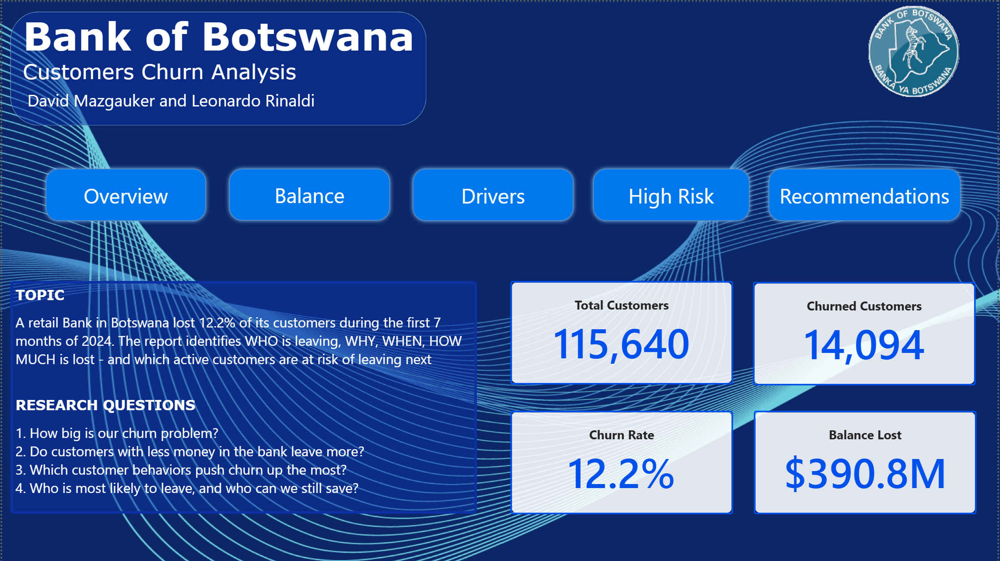
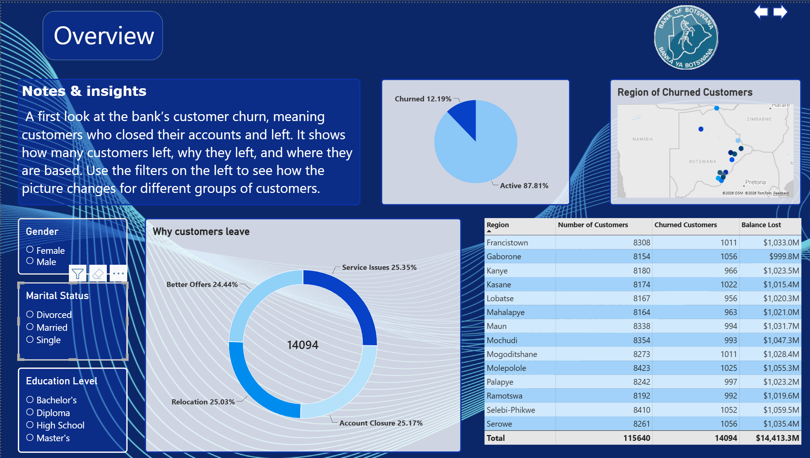
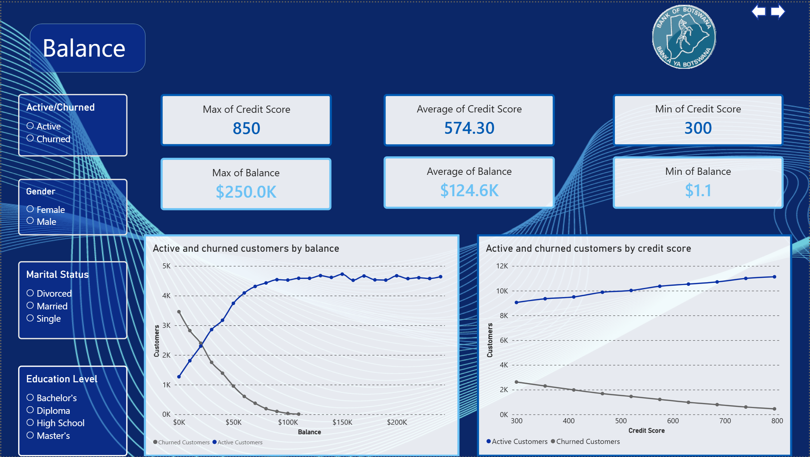
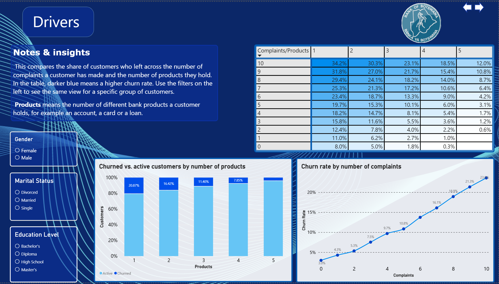
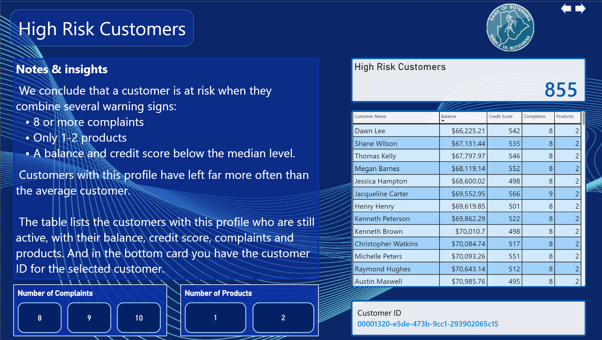
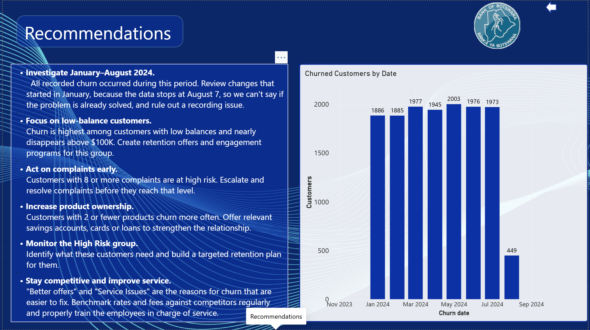

# Bank Customer Churn: Power BI Report

An interactive, six-page Power BI report on **115,640 bank customers**. It answers four questions: how big the churn problem is, whether low balances matter, which behaviors drive churn, and which active customers the bank should try to keep.

Built for the Data Analysis program at John Bryce Academy (Project 4), together with **David Mazgauker**. It uses the same dataset as the [Python analysis](../README.md) in this repository.

## View the report

**Quickest:** open [`bank-churn-dashboard.pdf`](bank-churn-dashboard.pdf) to see all six pages right in GitHub, with no software needed.

**Interactive version:**

1. Download [`bank-churn-dashboard.pbix`](bank-churn-dashboard.pbix).
2. Open it with **Power BI Desktop** (free, Windows only). The data is stored inside the file, so nothing else is needed.

GitHub cannot preview `.pbix` files, so every page is also shown in the screenshots below.

## Screenshots

| | |
|---|---|
|  |  |
|  |  |
|  |  |

## The four questions

The report is built around the research questions on its Home page. Each page answers one of them.

| Page | Question | What it shows |
|---|---|---|
| **Overview** | How big is our churn problem? | Churned vs. active customers, the reasons customers gave for leaving, and churn by region |
| **Balance** | Do customers with less money in the bank leave more? | Active and churned customers by balance and by credit score |
| **Drivers** | Which customer behaviors push churn up the most? | Churn rate by number of complaints and by number of products, and the two combined in a heat-map matrix |
| **High Risk** | Who is most likely to leave, and who can we still save? | A list of active customers who match the high-risk profile |

The **Home** page introduces the project. The **Recommendations** page turns the findings into six actions for the bank and shows churned customers by month.

## What the report found

- **12.2% of customers churned** (14,094 of 115,640) between January and early August 2024. The four stated reasons (Account Closure, Service Issues, Relocation, Better Offers) are close to evenly split, so there is no single dominant cause.
- **Low balances leave.** Churned customers have a median balance of about **$23.0K**, against **$139.8K** for retained customers, and no churned customer holds more than **$117,664**.
- **Complaints push churn up steadily:** from **3.0% with no complaints to 23.6% with 10**.
- **More products, less churn:** from **20.9% with 1 product to 4.4% with 5**.
- **The combination matters most.** In the complaints x products matrix, churn ranges from **0.3%** (0 complaints, 4 products) to **34.2%** (10 complaints, 1 product).
- **Who the customer is does not matter.** Gender, marital status and education level show no meaningful difference (confirmed in the Python analysis).
- **A watchlist of 855 active customers** who match the high-risk profile below.

## How "high risk" is defined

An **active** customer is flagged when they meet all four conditions:

- 8 or more complaints
- 1 or 2 products
- a balance below $124,505.89 (the median)
- a credit score below 574 (the median)

Customers with this kind of profile churn far more often than average. In the Python analysis, the stricter 1-product version of this group churned at 78.6%, about 6x the baseline. That version gives a smaller list of 334 active customers, while this report uses 1-2 products, so its list is longer.

## Under the hood

- **Data model:** two linked tables (customer details, and bank and behavior data) plus a table of measures: Churn Rate, Total Customers, Churned Customers, Active Customers and Balance Lost.
- **Binned columns** for credit score and churn date, used as chart axes.
- **Visuals:** KPI cards, donut and pie charts, line charts, a 100% stacked column chart, a matrix with conditional formatting, a map, tables, and slicers for gender, marital status and education level.
- **Design:** a custom theme and one consistent layout across all pages.

## Data and limitations

- **Source:** [Bank Customer Churn](https://www.kaggle.com/datasets/sandiledesmondmfazi/bank-customer-churn) on Kaggle (author: sandiledesmondmfazi). The data is **synthetic**: customer names and relationships are generated, not real people or real behavior.
- **Region is random.** The original addresses did not fit a Botswana bank, so regions were assigned randomly in Python. The region map and table carry no signal.
- **Churn dates cover January to 7 August 2024.** August is a partial month, so its lower count is not a real decline.
- **Association, not causation.** The report describes patterns and does not predict churn.
- **Not affiliated with the Bank of Botswana.** Its name and logo are used only to theme a learning project, and the data does not come from that bank.

## Credits

Built by **Leonardo Rinaldi** and **David Mazgauker** · Data Analysis program, John Bryce Academy.
[LinkedIn](https://www.linkedin.com/in/leonardo-rinaldi-5706b4436/)
